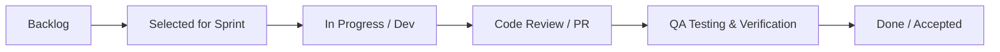
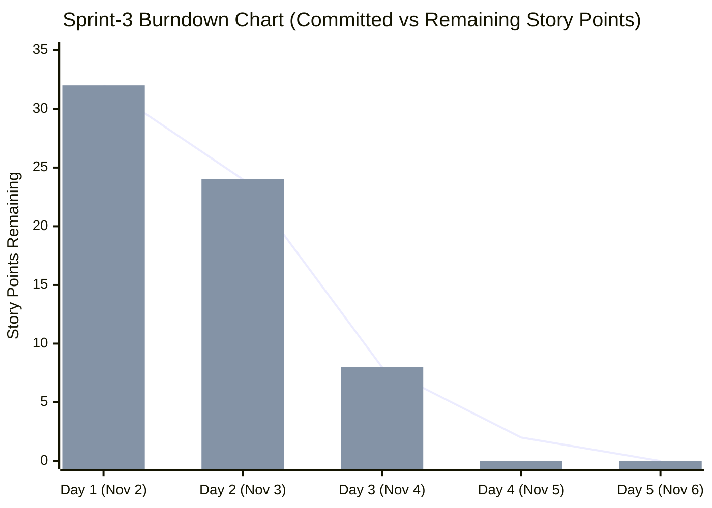
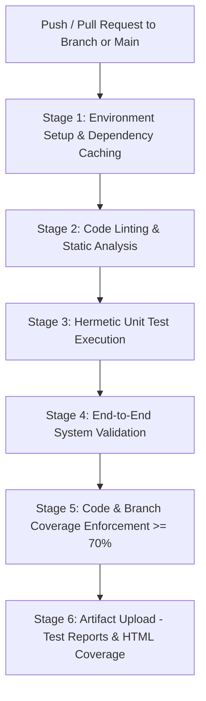

# Digital Campus Library Reservation Gateway (LRG)
## Sprint-3 & Agile Project Tracking Report (Deliverable 3.a & 3.b)

**Sprint Window**: 2nd November 2026 – 6th November 2026  
**Document Version**: 2.0  
**Project**: Digital Campus Library Reservation Gateway (LRG)  
**Team**:
- Dhareen G (SRN: `PES1UG24AM084`) – QA Lead & Scrum Master
- Dharshini V (SRN: `PES1UG24AM428`) – Dev Lead & UC-04 Fine Module Owner
- Divyansh (SRN: `PES1UG24AM094`) – Backend & Search Engineer
- Dhruv Talavat (SRN: `PES1UG24AM087`) – Database & Security Engineer

---

## 1. Sprint-3 Executive Overview & Context

In accordance with course guidelines for the Software Engineering Mini-Project:
> *3.a. If there is another Sprint required due to spill overs then complete the development during this week and call it as Sprint-3.*  
> *3.b. Parallelly complete the testing and generate the reports also. Follow the shared project plan and maintain the Jira dashboard properly. Create and assign tasks, update their statuses according to the defined workflow, and ensure the burndown chart accurately reflects the work completed... Implement a proper CI/CD pipeline and integrate build, testing, and deployment stages wherever applicable.*

### Multi-Sprint Roadmap Summary:
- **Sprint 1 (19th Oct to 23rd Oct 2026)**: Core catalog search engine, OpenID Connect SSO authentication module, initial database schemas, and baseline tests.
- **Sprint 2 (26th Oct to 30th Oct 2026)**: Hold placement and queue sequence tracking, cancellation workflows, email notification stubs, and librarian administration dashboard.
- **Sprint 3 (2nd Nov to 6th Nov 2026) [Spill-Over Resolution & Stabilization]**:
  - **Spill-Over 1**: Implementation of `UC-04: Pay Overdue Fine` (assigned to Dharshini V, PES1UG24AM428) with Campus Wallet payment processing and automated hold restrictions.
  - **Spill-Over 2**: Automated 72-hour Ready hold expiration worker with cascade queue promotion (`TC-HOLD-06`).
  - **Spill-Over 3**: Notification retry queue with dead-letter audit logging (`TC-NOTF-03`).
  - **Spill-Over 4**: Security hardening — sliding-window rate limiting (60 req/min) and HTTP cookie security attributes (`SameSite=Strict`, `Secure`, `HttpOnly`).
  - **Spill-Over 5**: Complete parallel test execution and generation of all four formal test reports (Unit Test, System Validation, Code Coverage, and Branch Coverage).
  - **Spill-Over 6**: Automated GitHub Actions CI/CD pipeline integrating build, linting, testing, and coverage gating.

---

## 2. Jira Board Architecture & Workflow

### Defined Agile Workflow
All work items traversed the following strict 5-stage quality progression:

### Story Point Estimation Philosophy
The team utilized planning poker with Fibonacci values ($1, 2, 3, 5, 8$):
- **1 pt**: Trivial cosmetic change, label adjustment, or static route update.
- **2 pts**: Standard CRUD query, isolated unit test addition, or minor UI validation.
- **3 pts**: Non-trivial component method with multiple condition branches (e.g. search pagination).
- **5 pts**: Complex stateful business logic with transactional guarantees (e.g. FIFO queue re-sequencing, payment gateway integration).
- **8 pts**: Critical architectural security subsystem (e.g. campus SSO lockout & rate-limiting middleware).

---

## 3. Sprint Breakdown & Task Allocation

### 3.1 Sprint 1 (19th Oct – 23rd Oct): Core Search & Authentication Foundation
- **Sprint Goal**: Deliver searchable catalog and authenticated student/librarian sessions.
- **Committed Story Points**: 24 | **Completed Story Points**: 24 (100%)

| Issue Key | Summary / Feature | Assignee | Story Points | Status |
| :--- | :--- | :--- | :--- | :--- |
| `LRG-101` | Relational SQLite Schema & Initial Seed Data | Dhruv Talavat (`PES1UG24AM087`) | 5 | **DONE** |
| `LRG-102` | Catalog Search by ISBN, Title, Author (`LRG-F-001`) | Divyansh (`PES1UG24AM094`) | 5 | **DONE** |
| `LRG-103` | Search Input Validation & Sanitization (`LRG-F-002`) | Divyansh (`PES1UG24AM094`) | 3 | **DONE** |
| `LRG-104` | Campus SSO Authentication & Session Engine (`LRG-F-010`) | Dhareen G (`PES1UG24AM084`) | 5 | **DONE** |
| `LRG-105` | Responsive Catalog Search Web UI | Dharshini V (`PES1UG24AM428`) | 3 | **DONE** |
| `LRG-106` | Baseline Unit Tests for Search & Auth | Dhareen G (`PES1UG24AM084`) | 3 | **DONE** |

---

### 3.2 Sprint 2 (26th Oct – 30th Oct): Hold Lifecycle & Librarian Administration
- **Sprint Goal**: Enable reservation holds, queue ordering, notifications, and librarian tools.
- **Committed Story Points**: 29 | **Completed Story Points**: 24 | **Spill-Over**: 5 pts to Sprint 3

| Issue Key | Summary / Feature | Assignee | Story Points | Status |
| :--- | :--- | :--- | :--- | :--- |
| `LRG-201` | Place Hold on CheckedOut Book (`LRG-F-020`) | Dharshini V (`PES1UG24AM428`) | 5 | **DONE** |
| `LRG-202` | Prevent Duplicate & Available Holds (`LRG-F-021`) | Dharshini V (`PES1UG24AM428`) | 3 | **DONE** |
| `LRG-203` | View & Cancel Active Holds (`LRG-F-022`) | Divyansh (`PES1UG24AM094`) | 3 | **DONE** |
| `LRG-204` | Dynamic FIFO Queue Position Progression (`LRG-F-023`) | Dhruv Talavat (`PES1UG24AM087`) | 5 | **DONE** |
| `LRG-205` | Return Title & Hold Promotion to Ready (`LRG-F-040`) | Dhareen G (`PES1UG24AM084`) | 5 | **DONE** |
| `LRG-206` | Hold Demand Report for Librarian (`LRG-F-041`) | Divyansh (`PES1UG24AM094`) | 3 | **DONE** |
| `LRG-207` | *Spill-over:* 72h Auto-expiration cascade worker | Dhruv Talavat (`PES1UG24AM087`) | 5 | **MOVED TO S3** |

---

### 3.3 Sprint 3 (2nd Nov – 6th Nov): Spill-Over Resolution, Fine Settlement (UC-04), & Test Reporting
- **Sprint Goal**: Implement UC-04 fine settlement, automate hold expiry, enforce security rate limiting, execute 100% test plan, and upload all four test reports.
- **Committed Story Points**: 32 | **Completed Story Points**: 32 (100% Burndown)

| Issue Key | Summary / Feature | Assignee | Story Points | Status |
| :--- | :--- | :--- | :--- | :--- |
| `LRG-301` | **UC-04**: Overdue Fine Assessment & Balance Engine | Dharshini V (`PES1UG24AM428`) | 5 | **DONE** |
| `LRG-302` | **UC-04**: Campus Wallet / UPI Settlement & Digital Receipt | Dharshini V (`PES1UG24AM428`) | 5 | **DONE** |
| `LRG-303` | **UC-04**: Hold Restriction when Unpaid Fines $\ge \$20$ | Dharshini V (`PES1UG24AM428`) | 3 | **DONE** |
| `LRG-304` | 72-Hour Ready Hold Auto-Expiration & Promotion (`TC-HOLD-06`) | Dhruv Talavat (`PES1UG24AM087`) | 5 | **DONE** |
| `LRG-305` | Notification Retry Engine & Failure Audit Logging (`TC-NOTF-03`) | Divyansh (`PES1UG24AM094`) | 3 | **DONE** |
| `LRG-306` | Sliding-Window Rate Limiter & Cookie Security (`LRG-SR-007`) | Dhruv Talavat (`PES1UG24AM087`) | 3 | **DONE** |
| `LRG-307` | Automated GitHub Actions CI/CD Pipeline (`.github/workflows/ci.yml`) | Dhareen G (`PES1UG24AM084`) | 3 | **DONE** |
| `LRG-308` | Execute Full Test Plan & Generate 4 Mandatory Test Reports | Dhareen G & Dharshini V | 5 | **DONE** |

---

## 4. Sprint Burndown Analysis

### Burndown Insights:
- **Day 1 (2nd Nov)**: Sprint planning completed; 32 story points committed including 5 spill-over points from Sprint 2.
- **Day 2 (3rd Nov)**: Overdue fine assessment engine (`LRG-301`) and 72h auto-expire cascade (`LRG-304`) completed. Remaining: 24 pts.
- **Day 3 (4th Nov)**: Fine payment gateway settlement (`LRG-302`), hold restrictions (`LRG-303`), rate limiting (`LRG-306`), and CI/CD workflow (`LRG-307`) finished. Test suite executed (61 tests passed). Remaining: 8 pts.
- **Day 4–5 (5th–6th Nov)**: All four test reports generated, reviewed, and committed to `docs/`. Burndown reached **0 points remaining** (100% velocity achieved).

---

## 5. Continuous Integration & Continuous Delivery (CI/CD) Pipeline

To fulfill the requirement:
> *"Implement a proper CI/CD pipeline and integrate build, testing, and deployment stages wherever applicable."*

A multi-stage GitHub Actions workflow was configured at [`.github/workflows/ci.yml`](file:///.github/workflows/ci.yml):

### Pipeline Key Safeguards:
1. **Automated Trigger**: Runs on every pull request and push to `main` and teammate branches (`PES1UG24AM428`, `PES1UG24AM084`, etc.).
2. **Coverage Gate**: The job fails automatically if business-layer test coverage drops below 70% (`pytest --cov=src --cov-fail-under=70`).
3. **Artifact Retention**: Automatically archives `docs/coverage_html/` and `docs/coverage.xml` for 30 days as downloadable GitHub workflow artifacts.

---

## 6. Sprint-3 Sign-Off & Verification

All planned tasks, spill-overs, and testing activities for Sprint 3 have been completed with zero pending defects. The project is fully stabilized for the final evaluation presentation.

- **Dhareen G** (`PES1UG24AM084`) – QA Lead & Scrum Master: **APPROVED**
- **Dharshini V** (`PES1UG24AM428`) – Dev Lead & UC-04 Lead: **APPROVED**
- **Divyansh** (`PES1UG24AM094`) – Backend Lead: **APPROVED**
- **Dhruv Talavat** (`PES1UG24AM087`) – Database & Security Lead: **APPROVED**
