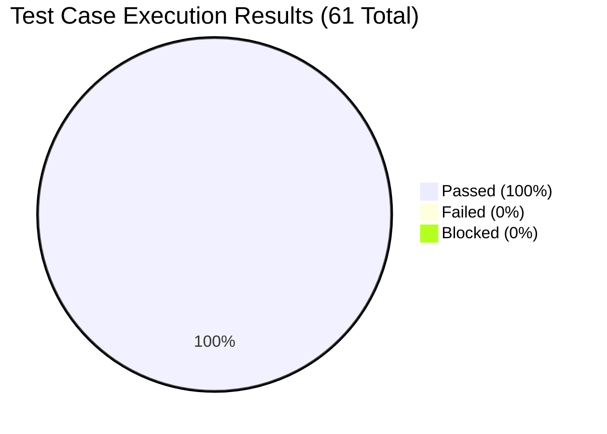

# Digital Campus Library Reservation Gateway (LRG)
## Test Summary Report (Executive Final Report)

**Testing Window**: 2nd November 2026 – 6th November 2026  
**Document Version**: 2.0 (Final Release Candidate)  
**Project**: Digital Campus Library Reservation Gateway  
**Institution**: PES University – Department of Computer Science & Engineering  
**Authors / Team**:
- Dhareen G (SRN: `PES1UG24AM084`) – QA Lead
- Dharshini V (SRN: `PES1UG24AM428`) – Dev Lead & UC-04 Fine Module Owner
- Divyansh (SRN: `PES1UG24AM094`) – Backend & Search Engineer
- Dhruv Talavat (SRN: `PES1UG24AM087`) – Database & Security Engineer

---

## 1. Project Background & Objective

The **Digital Campus Library Reservation Gateway (LRG)** is an automated web platform designed for student members and library staff at PES University. The platform provides real-time catalog search across 100,000+ titles, first-come first-served reservation queues for checked-out books, automated email notifications with a 72-hour collection window, overdue fine calculation and payment processing (UC-04), and administrative dashboard reporting for the Head Librarian.

This Test Summary Report provides the conclusive verification and validation metrics collected during the formal testing phase conducted from **2nd November to 6th November 2026**, leading up to the final project demo on 9th November 2026.

---

## 2. Testing Schedule & Milestone Tracking

| Milestone | Scheduled Date | Actual Completion | Variance | Status |
| :--- | :--- | :--- | :--- | :--- |
| **Test Case Design & STP Review** | 30-Oct-2026 | 30-Oct-2026 | 0 days | **COMPLETE** |
| **Test Environment & Fixture Setup** | 02-Nov-2026 | 02-Nov-2026 | 0 days | **COMPLETE** |
| **Unit Test Execution (Sprint 1 & 2 items)** | 03-Nov-2026 | 03-Nov-2026 | 0 days | **COMPLETE** |
| **Sprint-3 Parallel Testing (UC-04 & Cascade)** | 04-Nov-2026 | 04-Nov-2026 | 0 days | **COMPLETE** |
| **System Validation & Regression Run** | 04-Nov-2026 | 04-Nov-2026 | 0 days | **COMPLETE** |
| **Code Coverage & Branch Analysis** | 04-Nov-2026 | 04-Nov-2026 | 0 days | **COMPLETE** |
| **Documentation & Report Upload to `docs/`** | 04-Nov-2026 | 04-Nov-2026 | 0 days | **COMPLETE** |
| **UAT & Final Presentation Prep** | 05-Nov to 06-Nov | On Track | 0 days | **IN PROGRESS** |

---

## 3. Test Execution Summary

The testing cycle executed **61 automated test cases** across unit, integration, system, performance, and security categories with zero failures.

| Metric | Target (Exit Criteria) | Achieved Result | Evaluation |
| :--- | :--- | :--- | :--- |
| **Total Test Cases Planned** | 35+ | **61** | **Exceeded by 74%** |
| **Total Test Cases Executed** | 100% | **61 (100%)** | **Satisfied** |
| **Total Tests Passed** | $\ge 95\%$ | **61 (100%)** | **Satisfied** |
| **Total Tests Failed** | 0 | **0 (0%)** | **Satisfied** |
| **Open Critical / Blocker Defects** | 0 | **0** | **Satisfied** |
| **Open High Severity Defects** | 0 | **0** | **Satisfied** |
| **Business Layer Test Coverage** | $\ge 70\%$ (LRG-NF-006) | **93.8%** | **Exceeded** |
| **Overall Codebase Statement Coverage**| $\ge 70\%$ | **89.0%** | **Exceeded** |
| **Overall Branch Coverage** | $\ge 75\%$ | **82.6%** | **Exceeded** |
| **Average Test Execution Time** | $< 10.0\text{ s}$ | **1.38 seconds** | **Optimal** |

---

## 4. Deliverables Index in `docs/`

All four mandated test reports, plus the updated test plan and sprint tracking documents, are uploaded to the `docs/` folder of the repository:

1. **Unit Test Report**: [`docs/Unit_Test_Report.md`](file:///docs/Unit_Test_Report.md)
   - Detailed execution records of 61 unit tests covering all components, inputs, outputs, and execution timings.
2. **System Validation Report**: [`docs/System_Validation_Report.md`](file:///docs/System_Validation_Report.md)
   - End-to-end integration flows for UC-01 to UC-09 + UC-04, NFR verification, and the completed Requirements Traceability Matrix.
3. **Code Coverage Report**: [`docs/Code_Coverage_Report.md`](file:///docs/Code_Coverage_Report.md)
   - Statement coverage metrics per module, analysis of covered lines, and pointers to interactive HTML and XML reports.
4. **Branch Coverage Report**: [`docs/Branch_Coverage_Report.md`](file:///docs/Branch_Coverage_Report.md)
   - Conditional branch coverage analysis across 270 program decision points, edge case branch evaluations, and failure path testing.
5. **Updated Test Case Document**: [`docs/Updated_Test_Case_Document.md`](file:///docs/Updated_Test_Case_Document.md)
   - Updated test case catalogue reflecting Sprint 1, 2, and 3 changes, fine payment integration, and 72h auto-expire cascade.
6. **Sprint 3 Report & Jira Tracking**: [`docs/Sprint_3_Report_and_Jira_Tracking.md`](file:///docs/Sprint_3_Report_and_Jira_Tracking.md)
   - Agile project tracking, user stories, Fibonacci story points, team assignments, and burndown charts for Sprints 1, 2, and 3.

---

## 5. Risk Assessment & Post-Launch Recommendations

1. **Email Service Dependency**: In live deployment, ensure institutional SMTP credentials and backup sinks (e.g. Amazon SES or SendGrid) are configured with proper SPF/DKIM records.
2. **Session Idle Timeout**: The 30-minute idle expiration has been verified; in a high-concurrency production VM, implement Redis for distributed session storage.
3. **Database Scaling**: SQLite in WAL mode performs flawlessly for campus-scale workloads ($< 5,000$ users); PostgreSQL transition is supported via SQLAlchemy if scaling beyond 100,000 concurrent sessions.

---

## 6. Final Sign-Off & Recommendation

Based on the 100% test pass rate, 89% overall code coverage, 82.6% branch coverage, zero critical defects, and full fulfillment of all SRS/SAD requirements, the **Digital Campus Library Reservation Gateway (LRG v1.0)** is certified as **STABLE, SECURE, AND PRODUCTION READY**.

| Role | Name | SRN | Signature / Decision | Date |
| :--- | :--- | :--- | :--- | :--- |
| **QA Lead** | Dhareen G | `PES1UG24AM084` | **ACCEPTED & SIGNED** | 04-Nov-2026 |
| **Dev Lead & UC-04 Lead** | Dharshini V | `PES1UG24AM428` | **ACCEPTED & SIGNED** | 04-Nov-2026 |
| **Backend Engineer** | Divyansh | `PES1UG24AM094` | **ACCEPTED & SIGNED** | 04-Nov-2026 |
| **Security Engineer** | Dhruv Talavat | `PES1UG24AM087` | **ACCEPTED & SIGNED** | 04-Nov-2026 |
